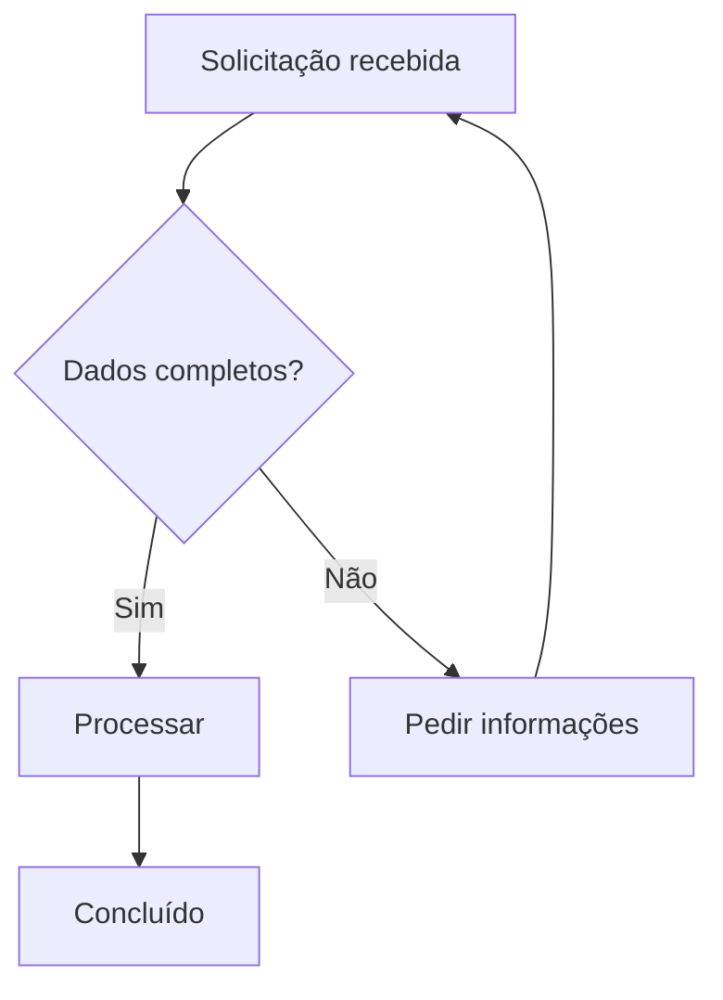

# criar-doc

Cria documentação clara e navegável, escrita para pessoas e não para IA. O público do documento precisa conseguir ler e entender tudo sem ajuda. Quando o documento ensina a fazer algo, o leitor também precisa conseguir reproduzir a aplicação ou o processo do zero, só seguindo o texto.

O trabalho tem quatro partes, nesta ordem: decidir público, tipo, idioma e local do arquivo; escrever seguindo a estrutura; fazer a revisão de consistência (coerência, coesão, funcionamento e origem dos resultados); e, por último, a revisão de naturalidade do texto.

## Antes de escrever

1. Identifique o assunto, o objetivo, o público e o tipo de documento (veja a seção seguinte). Essa decisão define o resto: o que entra, o nível de detalhe e quais seções fazem sentido.
2. Escreva no idioma do repositório ou do documento que já existe. Se não houver nenhum dos dois, use o idioma do usuário (padrão: português do Brasil).
3. Se estiver trabalhando numa pasta de projeto e o usuário não disser onde salvar, crie um arquivo `.md` na pasta `instructions/` da raiz do projeto, com nome curto em minúsculas, sem acentos e com hífens (ex.: `instructions/deploy-azure.md`). A exceção é o README, que se chama `README.md` e fica na pasta que ele descreve.
4. Se faltar informação essencial (versões, dependências, credenciais necessárias, ordem das etapas, origem dos dados), pergunte antes, em no máximo 1 a 3 perguntas objetivas.

## Público e tipo de documento

O tipo de documento diz o que precisa entrar:

| Tipo | Para que serve | O que entra |
|---|---|---|
| Tutorial ou passo a passo | Ensinar alguém a fazer algo do zero | Pré-requisitos com versões e onde obter, etapas numeradas com o resultado esperado de cada uma ("você deve ver a mensagem X") e uma seção "Como verificar se deu certo" |
| Guia de tarefa | Ajudar quem já usa o sistema a cumprir uma tarefa específica | As etapas da tarefa, direto ao ponto, explicando só o que é próprio dela |
| Referência | Consulta rápida de comandos, parâmetros ou campos | Tabelas e listas com pouca narrativa, sem passo a passo |
| Explicação ou relatório | Fazer entender como algo funciona, ou apresentar resultados e decisões | Contexto, porquês e resultados com origem (veja a regra mais abaixo); comandos só se forem necessários para refazer os números |

O público diz o nível de detalhe:

- Técnico do mesmo assunto: não explique os termos básicos da área. Para quem trabalha com ROS 2, "nó" e "tópico" dispensam explicação. Explique o que é próprio do projeto.
- Técnico de outra área ou iniciante: explique cada termo técnico na primeira vez que ele aparece (ex.: "API, a forma como dois sistemas conversam entre si").
- Gestão: comece pela conclusão e pelo impacto em custo, prazo e risco. Detalhes técnicos vão para um anexo ou um link.
- Usuário final: só as ações que ele faz na tela ou no sistema, sem detalhes de implementação.

Na dúvida, escreva para alguém competente que nunca viu este projeto.

## Como escrever

- Explique o porquê, não só o quê. Cada etapa importante diz o que fazer e por que isso é necessário.
- Não deixe nada implícito. Nada de pular passos "óbvios" ou escrever "configure normalmente" e "como de costume": se é preciso fazer, está escrito.
- Use frases curtas, voz ativa, palavras do dia a dia e tom de quem ensina. Depois de apresentar um termo, chame a coisa sempre pelo mesmo nome (não alterne "servidor", "backend" e "API" para a mesma coisa).
- Evite formato de máquina: listas de palavras-chave soltas, instruções do tipo prompt, blocos densos de regras e textos telegráficos. Escreva como um bom colega explicaria pessoalmente.
- Comandos e código vão completos, com a linguagem indicada no bloco e prontos para copiar. Use valores de exemplo concretos; quando o leitor precisar trocar algo, diga o que trocar e por quê.
- Listas numeradas servem para etapas em ordem, e marcadores para itens sem ordem. Tabelas, só para comparar opções, listar parâmetros ou apresentar resultados.

## Regra: todo resultado tem origem explicada

**Nunca apresente um resultado sem explicar de onde ele vem ou como se chegou a ele.** Isso vale para números, totais, percentuais, médias, métricas, saídas de comandos, conclusões, tabelas e gráficos.

Para cada resultado, deixe claro:
- De onde vem: a fonte dos dados (arquivo, tabela do banco, planilha, sistema, relatório, medição, link), com período ou data quando fizer diferença.
- Como foi obtido: o comando, a consulta, a fórmula ou os passos usados para chegar ao valor.
- O cálculo, quando houver, com os números reais. Exemplo: "Taxa de erro = 12 falhas ÷ 400 requisições = 3%".
- Premissas e filtros: o que entrou e o que ficou de fora (ex.: "só pedidos com status pago", "sem contar finais de semana").

Para tabelas e gráficos de resultado:
- Antes ou logo depois da tabela, escreva uma frase dizendo o que ela mostra e como os valores foram obtidos.
- Logo abaixo, coloque uma linha de referência no formato `Fonte: <origem dos dados> — <como foi calculado>`.
- Explique a fórmula das colunas calculadas (ex.: "Margem = (Receita − Custo) ÷ Receita").

Se a origem de um valor não for conhecida, **não invente**: pergunte ao usuário ou marque o trecho no texto como pendente de confirmação.

## Estrutura

### Título
Um título curto e direto (`# Nome do documento`).

### Introdução
De 2 a 4 frases dizendo o que o documento aborda, para quem é e o que o leitor vai conseguir fazer ou entender ao final. Sem detalhes técnicos: só o panorama, numa linguagem que qualquer pessoa entenda.

### Índice com links
- É obrigatório quando o documento tem 4 seções (títulos `##`, sem contar o próprio índice) ou mais. Em documentos menores, é opcional.
- Fica logo após a introdução, sob `## Índice`, com uma entrada por seção (e pelas subseções relevantes) e o link para a âncora de cada uma.
- As âncoras seguem a regra do GitHub: o título vai para minúsculas, os acentos ficam, a pontuação e os símbolos somem e cada espaço vira um hífen, inclusive os espaços que ficavam em volta de um símbolo removido. Exemplos:
  - `## Visão geral` vira `#visão-geral`.
  - `## 1. Instalação` vira `#1-instalação`.
  - `## Nuvem × local` vira `#nuvem--local`, com dois hífens.
  - `## 🚀 Início` vira `#-início`.
  - Títulos repetidos ganham sufixo: o segundo `## Exemplo` vira `#exemplo-1`.
- Outros visualizadores, como a pré-visualização do VS Code, podem gerar âncoras diferentes quando o título tem símbolos. Para o link funcionar em qualquer lugar, prefira títulos sem símbolos nem emojis.

### Diagrama
- Inclua um diagrama quando o documento descreve um processo, uma decisão, uma arquitetura, a interação entre sistemas ou pessoas, os estados de um item ou um modelo de dados. Se não houver nada disso (num glossário, num FAQ ou numa referência de parâmetros, por exemplo), não force: um diagrama sem função só ocupa espaço.
- Escolha o tipo pelo conteúdo:
  - Processo, passo a passo ou decisão: fluxograma (`flowchart TD`).
  - Interação entre sistemas ou pessoas ao longo do tempo: diagrama de sequência (`sequenceDiagram`).
  - Arquitetura ou componentes: `flowchart LR` com subgrafos.
  - Estados de um item, como um pedido ou um ticket: `stateDiagram-v2`.
  - Modelo de dados: `erDiagram`.
- Use Mermaid, num bloco de código marcado como `mermaid`, com até uns 12 nós e rótulos curtos no idioma do documento.
- Logo abaixo, explique em 1 a 3 frases como ler o diagrama, como se estivesse mostrando para alguém pela primeira vez.
- Duas armadilhas comuns impedem o Mermaid de renderizar:
  - Parênteses, colchetes ou chaves no rótulo sem aspas: escreva `A["Custo (US$)"]`, e não `A[Custo (US$)]`.
  - Um nó chamado `end`, em minúsculas: use `fim` ou `End`.

Exemplo de fluxograma:

### Seções de conteúdo
Escolha as seções conforme o tipo de documento e deixe de fora as que não fizerem sentido. As mais comuns são: visão geral (o que é e para que serve), como funciona (onde costuma entrar o diagrama), pré-requisitos, passo a passo, como verificar se deu certo, resultados, exemplos de uso, erros comuns (o sintoma que a pessoa vê, a causa e a solução), perguntas frequentes, glossário e referências.

## Revisão de consistência (obrigatória, antes da de naturalidade)

Com o documento completo, releia tudo do início ao fim como se fosse o leitor seguindo as instruções pela primeira vez. Corrija cada problema antes de passar para a revisão de naturalidade.

### Coerência
- A introdução promete exatamente o que o documento entrega, nem mais, nem menos.
- Nomes, versões, portas, caminhos, variáveis e valores de exemplo são os mesmos em todas as seções, nos comandos e no diagrama.
- O diagrama mostra o mesmo fluxo do texto: mesmas etapas, mesma ordem, mesmos nomes.
- Nenhuma afirmação contradiz outra (ex.: um pré-requisito dito opcional num lugar e obrigatório em outro).
- O conteúdo e o nível de detalhe combinam com o público e o tipo escolhidos antes de escrever.

### Coesão
- O leitor nunca precisa de algo que só é explicado mais adiante.
- Cada termo é explicado antes ou na primeira vez que aparece, e depois é sempre chamado pelo mesmo nome.
- Referências internas ("veja a seção X", "o arquivo criado no passo 3") apontam para o lugar certo.
- Não há trechos repetidos nem seções soltas, sem ligação com o resto.
- O índice, quando existe, reflete exatamente os títulos e a ordem do documento, e cada link bate com a âncora gerada pela regra da seção "Índice com links".

### Funcionamento
- Simule o passo a passo na ordem: cada etapa usa só o que já foi instalado, criado ou configurado nas anteriores.
- Todo pré-requisito usado nas etapas aparece na seção de pré-requisitos, e vice-versa.
- Comandos e código estão completos, com sintaxe correta, e podem ser copiados e colados sem ajuste (exceto onde o texto avisa o que trocar).
- Quando houver ambiente disponível, execute os comandos e trechos de código para confirmar que funcionam. Não execute os que criam recursos cobrados (máquinas na nuvem, bancos de dados gerenciados, serviços pagos), apagam dados ou alteram sistemas externos. Revise esses com cuidado e marque no texto que não foram testados, como tudo o que não pôde ser testado por falta de ambiente.
- Cada etapa importante tem o resultado esperado, e a seção "Como verificar se deu certo" de fato confirma o funcionamento.
- O diagrama Mermaid tem sintaxe válida e renderiza (veja as armadilhas na seção "Diagrama").

### Origem dos resultados
Percorra o documento procurando todo número, total, percentual, métrica, conclusão, saída de comando, tabela e gráfico de resultado. Para cada um, confirme:
- Está explicado de onde veio e como se chegou ao valor.
- Se houve cálculo, a conta aparece com os números reais e, refeita, dá o mesmo resultado.
- Tabelas e gráficos de resultado têm a frase explicando o que mostram e a linha `Fonte:` logo abaixo, e as colunas calculadas têm a fórmula.
- Os mesmos resultados têm os mesmos valores em todas as seções (texto, tabelas, gráficos e conclusões).
- Os totais e subtotais das tabelas batem com as linhas.

Corrija qualquer resultado sem referência: acrescente a origem e o cálculo ou, se a origem não for conhecida, sinalize no texto e pergunte ao usuário na entrega. Nunca invente uma fonte. O mesmo vale para qualquer outra lacuna que só o usuário pode preencher, como uma versão, uma credencial ou uma regra de negócio.

## Revisão de naturalidade (obrigatória, por último)

Depois da revisão de consistência, releia todo o texto procurando trechos que soam como escritos por um modelo de IA e reescreva-os para que pareçam escritos por uma pessoa.

### Sinais objetivos (meta: zero)
São fáceis de achar e de trocar, então nenhum deve sobrar:
- Expressões-clichê: "vale ressaltar", "é importante destacar", "é importante notar", "em resumo", "em suma", "ademais", "nesse sentido", "no cenário atual", "mergulhar em", "desvendar", "jornada", "robusto", "poderoso", "perfeito", "sem complicações", "de forma eficiente e eficaz", "por fim, mas não menos importante". A exceção é quando a palavra é termo técnico do assunto, como "estimador robusto" em estatística.
- A construção "não apenas X, mas também Y".
- Aberturas e fechamentos vazios: frases que anunciam o que vem ("Nesta seção, vamos explorar..."), conclusões que repetem o que já foi dito e ofertas genéricas ("Esperamos que este guia tenha sido útil!").
- Emojis decorativos.

### Sinais subjetivos (julgamento)
Dependem do contexto, então avalie lendo o texto como um leitor:
- Ritmo repetitivo: frases ou itens todos do mesmo tamanho, itens de lista que começam todos do mesmo jeito, enumerações sempre em trios.
- Excesso de formatação: negrito em quase toda frase, travessões em excesso, subtítulos para blocos de uma linha só.
- Tom artificial: entusiasmo exagerado, formalidade forçada, rodeios ("pode ser que, em alguns casos, talvez...") e frases genéricas que serviriam para qualquer projeto.
- Palavras infladas: "crucial", "potencializar", "alavancar", "revolucionário" e afins. Às vezes são a palavra certa, então troque só quando estiverem enfeitando a frase (ex.: "potencializar o desempenho" vira "deixar mais rápido", se for isso que quer dizer).

### Como reescrever
- Diga a coisa direto, como explicaria a um colega ao lado. Corte a frase de abertura se ela só anuncia o conteúdo.
- Troque palavras infladas por palavras comuns ("robusto" vira "aguenta muito acesso sem cair", se for isso que quer dizer).
- Varie o tamanho das frases e o início dos itens de lista.
- Use exemplos concretos do próprio projeto no lugar de afirmações genéricas.
- Deixe negrito só onde o leitor realmente precisa parar e prestar atenção.
- Não altere o conteúdo técnico: comandos, código, valores, resultados, fontes, cálculos, versões e diagramas continuam iguais. Se precisar mudar um título, atualize o link dele no índice.

### Rodadas
1. Procure cada sinal objetivo no texto inteiro (com a busca de texto, se tiver uma) e reescreva todos os trechos onde ele aparecer.
2. Releia o texto avaliando os sinais subjetivos e reescreva os trechos que soarem artificiais.
3. Se ainda sobrar algum sinal, repita os dois passos. Faça no máximo 3 rodadas, para não descaracterizar o texto; se depois disso restar algum sinal subjetivo, fique com a versão mais clara.

## Antes de entregar
- [ ] Público, tipo, idioma e local do arquivo foram decididos antes de escrever, e o documento respeita essas escolhas.
- [ ] Há título e introdução, e o índice existe se o documento tiver 4 seções ou mais.
- [ ] Há diagrama, com a explicação de como lê-lo, se o documento descreve processo, decisão, arquitetura, interação, estados ou modelo de dados.
- [ ] As duas revisões foram feitas, na ordem.
- [ ] Nada foi inventado: as dúvidas que só o usuário pode resolver foram perguntadas ou sinalizadas no texto.
